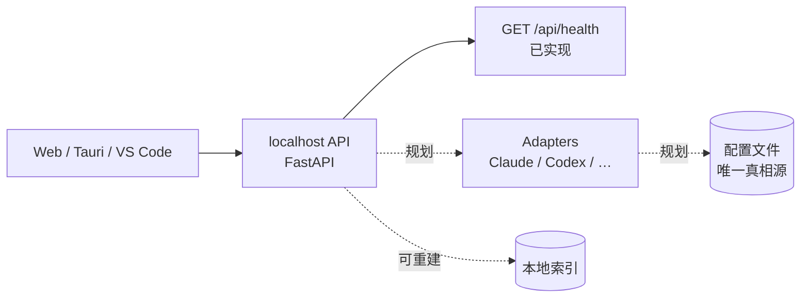

# CC-Roster

[](https://github.com/xming-cell/cc--/actions/workflows/ci.yml)

把电脑上所有 AI 编程工具的配置收进一个面板统一管理，并为在线聊天、agent 能力预留入口。

## 为什么

AI 编程工具越来越多，配置却散落在各自的目录和格式里：

1. **难找**：Claude Code、Codex 等工具的配置位置、字段各不相同，换台机器就要重新翻一遍。
2. **难管**：想统一查看或批量调整时，没有一处可以总览的地方。
3. **难扩展**：希望在一个面板里完成配置管理、在线聊天和 agent 会话，而不是在多个工具之间来回切换。

CC-Roster 不做「又一个 AI 客户端」，而是先把配置这层基础设施做好。

## 当前状态

**v0.0.1 · 规划阶段。** 当前任务卡为 `specs/002-decision-baseline`（决策与架构基线；001 已完成）。

已落地：

- FastAPI 后端 + `GET /api/health`
- Vue 3 前端首页调用健康检查并展示状态
- 后端 / 前端各 1 个测试
- `scripts/check.py` 一键验收，GitHub Actions CI 已接通
- 需求草案、后续任务拆解与架构决策（`docs/requirements.md`、`docs/task-plan.md`、`docs/decisions.md`）

规划中：

- 配置适配器：读取 Claude Code、Codex 等工具的配置
- 配置面板：只读展示 → 可回滚写入
- 在线聊天与 agent 会话

## 设计原则

1. **配置文件是唯一真相源**，数据库只是可重建的索引。
2. **先只读，后写入**；任何写入都必须可回滚。
3. **不自己造 agent runtime**，CLI 就是后端。

## 架构

目标架构如下，虚线部分尚未实现：



## 技术栈

| 层 | 技术 |
|---|---|
| 后端 | Python 3.12 · FastAPI · Pydantic v2 · uv |
| 前端 | Vue 3 · TypeScript · Vite · Pinia · Vue Router · pnpm |
| 质量 | Ruff · mypy · pytest · Oxlint / ESLint · vue-tsc · Vitest |
| CI | GitHub Actions |

## 快速开始

### 环境要求

- Python ≥ 3.12，包管理使用 [uv](https://docs.astral.sh/uv/)
- Node.js `^22.18.0 || >=24.12.0`，包管理使用 pnpm（CI 使用 9.x）
- 当前骨架无需数据库，健康检查不依赖外部服务

### 1. 启动后端

```bash
cd backend
uv sync --locked
uv run uvicorn app.main:app --reload
```

- 健康检查：<http://127.0.0.1:8000/api/health> → `{"status":"ok"}`
- 接口文档：<http://127.0.0.1:8000/docs>

### 2. 启动前端

另开一个终端：

```bash
cd frontend
pnpm install --frozen-lockfile
pnpm dev
```

打开 <http://localhost:5173>。Vite 会把 `/api` 代理到 `http://127.0.0.1:8000`，见 `frontend/vite.config.ts`。

### 3. 一键验收

在仓库根目录运行：

```bash
uv run python scripts/check.py
```

它会依次执行：

1. `guard scope` / `guard forbidden`：改动范围与禁用写法检查
2. 后端：Ruff lint、Ruff format、mypy、pytest
3. 前端：类型检查、lint、Vitest

**退出码为 0 是唯一的完成信号。**

## 目录结构

```text
.
├── backend/                 # FastAPI 服务
│   ├── src/app/api/         # 路由（参考 health.py）
│   ├── src/app/core/        # 配置等基础设施
│   └── tests/
├── frontend/                # Vue 3 前端
│   └── src/
├── scripts/
│   ├── check.py             # 一键验收
│   └── guards.py            # 改动范围 / 禁用写法硬门禁
├── specs/                   # 任务卡；CURRENT 指向当前任务
├── rules/                   # 后端 / 前端 / 测试 / 提交细则
├── AGENTS.md                # AI 协作硬约定（开工前先读）
└── PROGRESS.md              # 跨会话交接状态
```

## 开发约定

- 开工前读 `AGENTS.md`、`rules/backend.md`、`rules/frontend.md`、`rules/testing.md`、`rules/git.md`。
- 当前任务看 `specs/CURRENT`；只改该任务卡 `scope` 块内的路径。
- 新增行为先写进任务卡的验收标准，再写实现。
- 一张任务卡对应一个 commit；`check.py` 通过后才提交。
- 详细规则以 `rules/` 为准，这里不重复。

## 文档

- [AGENTS.md](AGENTS.md)：AI 协作硬约定与验证命令
- [PROGRESS.md](PROGRESS.md)：当前进度、下一个可执行命令、已知坑
- [docs/requirements.md](docs/requirements.md)：产品需求草案
- [docs/task-plan.md](docs/task-plan.md)：后续任务拆解（初稿）
- [docs/decisions.md](docs/decisions.md)：已确认的架构决策（ADR-001～ADR-008）
- [rules/](rules/)：后端、前端、测试、提交细则
- [specs/](specs/)：任务卡与当前任务指针

## 许可证

[MIT](LICENSE) © 2026 xming-cell