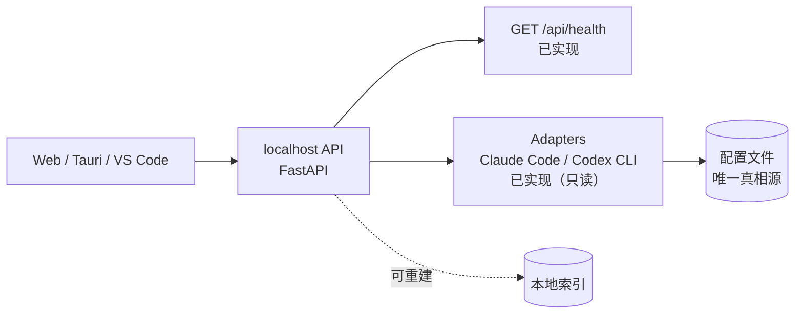

# CC-Roster

[](https://github.com/xming-cell/cc--/actions/workflows/ci.yml)

把电脑上所有 AI 编程工具的配置收进一个面板统一管理，并为在线聊天、agent 能力预留入口。

## 为什么

AI 编程工具越来越多，配置却散落在各自的目录和格式里：

1. **难找**：Claude Code、Codex 等工具的配置位置、字段各不相同，换台机器就要重新翻一遍。
2. **难管**：想统一查看或批量调整时，没有一处可以总览的地方。
3. **难扩展**：希望在一个面板里完成配置管理、在线聊天和 agent 会话，而不是在多个工具之间来回切换。

CC-Roster 不做「又一个 AI 客户端」，而是先把配置这层基础设施做好。

## 当前状态

**v0.0.1 · 基础设施阶段。** 任务卡 005（微信式主界面骨架）已完成；001–004 已完成。

已落地：

- FastAPI 后端 + `GET /api/health`；所有错误统一返回 `{code, message}`
- 跨平台数据目录、SQLite 索引（WAL + `user_version` 幂等迁移）、原子 JSON 写与跨平台文件锁
- 结构化日志（stdout + 文件）与按 ADR-006 三档规则实现的密钥脱敏
- 本地安全边界：仅监听 `127.0.0.1`、CORS 白名单、1 MiB 请求体上限
- Vue 3 前端请求层（统一 `ApiError`）、路由、Pinia store 与应用壳；`/` 为微信式主界面：左侧好友列表、右侧详情 / 会话区骨架
- 主界面视觉 token（`frontend/src/styles/tokens.css`）：颜色 / 字号 / 间距 / 圆角 / 头像 / 气泡，提供 `--friend-accent` / `--friend-avatar-bg` / `--bubble-*` 覆盖点
- 工具发现（只读）：Claude Code / Codex CLI 适配器、`GET /api/tools`、`GET /api/tools/{tool_id}`、`/` 主界面与 `/tools` 过渡入口；密钥只返回脱敏预览，读取不写盘
- `scripts/check.py` 一键验收（含改动范围 / 禁用写法门禁），GitHub Actions CI 已接通
- 需求草案、后续任务拆解与架构决策（`docs/requirements.md`、`docs/task-plan.md`、`docs/decisions.md`）

规划中：

- 配置写入：可回滚地修改工具配置
- 在线聊天与 agent 会话

## 设计原则

1. **配置文件是唯一真相源**，数据库只是可重建的索引。
2. **先只读，后写入**；任何写入都必须可回滚。
3. **不自己造 agent runtime**，CLI 就是后端。

## 架构

目标架构如下，虚线部分尚未实现：



## 技术栈

| 层 | 技术 |
|---|---|
| 后端 | Python 3.12 · FastAPI · Pydantic v2 · uv |
| 前端 | Vue 3 · TypeScript · Vite · Pinia · Vue Router · pnpm |
| 质量 | Ruff · mypy · pytest · Oxlint / ESLint · vue-tsc · Vitest |
| CI | GitHub Actions |

## 快速开始

### 环境要求

- Python ≥ 3.12，包管理使用 [uv](https://docs.astral.sh/uv/)
- Node.js `^22.18.0 || >=24.12.0`，包管理使用 pnpm（CI 使用 9.x）
- 首次启动会自动创建 SQLite 索引与日志目录，无需手工建库

### 1. 启动后端

```bash
cd backend
uv sync --locked
uv run uvicorn app.main:app --reload --host 127.0.0.1 --port 8000
```

- 只监听回环地址 `127.0.0.1`，不提供局域网 / 远程访问。
- 启动时创建 `<数据目录>/db/app.sqlite3` 与 `<数据目录>/logs/`，数据目录见「本地数据目录」。
- 健康检查：<http://127.0.0.1:8000/api/health> → `{"status":"ok"}`
- 接口文档：<http://127.0.0.1:8000/docs>
- 删除 `<数据目录>/db/app.sqlite3` 后重启会自动重建，不需要迁移命令。

### 2. 启动前端

另开一个终端：

```bash
cd frontend
pnpm install --frozen-lockfile
pnpm dev
```

打开 <http://localhost:5173> 即进入微信式主界面：左侧是已发现 AI 工具的好友列表，右侧显示选中工具的详情；`/tools` 保留为工具发现的过渡入口。Vite 会把 `/api` 代理到 `http://127.0.0.1:8000`，见 `frontend/vite.config.ts`。

### 3. 一键验收

在仓库根目录运行：

```bash
uv run python scripts/check.py
```

它会依次执行：

1. `guard scope` / `guard forbidden`：改动范围与禁用写法检查
2. 后端：Ruff lint、Ruff format、mypy、pytest
3. 前端：类型检查、lint、Vitest

**退出码为 0 是唯一的完成信号。**

## 主界面（微信式骨架）

`/` 是打开即见的微信式主界面，数据来自 `GET /api/tools`：

- **好友 = 已安装的 AI 工具**（ADR-002）。左侧列表每行含头像位、名称、一行状态描述与四态徽章（正常 / 未配置 / 异常 / 检测中），按 `last_modified` 降序排列，时间缺失或非法排最后，同值按名称 / ID 稳定排序。
- 点击好友后，右侧显示名称、状态与 004 的只读配置详情（供应商、模型、接口地址、第三方中转、脱敏密钥、最后修改时间、配置路径与 warnings）；未选中时显示「选择一个 AI 查看详情」。会话时间线容器已预留，本阶段不渲染会话内容。
- 无工具时显示「还没有发现任何 AI 工具」与「怎么装」静态指引（Claude Code / Codex CLI，不发网络请求）；部分工具失败时其他好友照常展示，全局 warnings 可折叠查看。
- 首屏先渲染骨架与「检测中」，初始失败给出可读错误与「重试」；刷新失败保留旧列表并给出非阻塞提示。
- 键盘可用：Tab 可达、Enter / Space 选中、focus 可见；窗口窄于 768px 时改为单列，无横向滚动。

`/tools` 保留为工具发现的过渡入口，行为与 004 一致，后续卡片会逐步并入主界面。

## 工具发现（只读）

`GET /api/tools` 返回已安装工具与顶层 warnings，`GET /api/tools/{tool_id}` 返回单个工具；未知 ID 返回 404 `{code: "TOOL_NOT_FOUND", message}`。前端页面为 <http://localhost:5173/tools>，列表展示状态、供应商、模型，详情展示接口地址、第三方中转、脱敏密钥、最后修改时间、配置路径与 warnings。

- 只读取用户级配置：Claude Code 的 `settings.json`（`CLAUDE_CONFIG_DIR`，默认 `~/.claude`）与 Codex CLI 的 `config.toml` + `auth.json`（`CODEX_HOME`，默认 `~/.codex`）；不读 OAuth / 登录凭据，不执行 CLI 子进程。
- 读取全程只读：不修改配置文件、不生成临时文件；密钥只以 `has_secret` + 脱敏 `secret_preview` 返回。
- 已安装判定：配置目录存在，或 `claude` / `codex` 在 `PATH` 中。只有可执行文件、没有配置时显示「未配置」。
- 环境变量为空串时回退默认目录；相对路径按用户 home 解析。

### 本地验收

用临时目录避免碰到真实配置（Windows PowerShell）：

```powershell
$root = Join-Path $env:TEMP "cc-roster-acceptance"
New-Item -ItemType Directory -Force "$root\claude", "$root\codex" | Out-Null
@'
{
  "model": "claude-sonnet-4-5",
  "env": {
    "ANTHROPIC_BASE_URL": "https://api.anthropic.com",
    "ANTHROPIC_AUTH_TOKEN": "sk-your-key"
  }
}
'@ | Set-Content "$root\claude\settings.json" -Encoding utf8

$env:CLAUDE_CONFIG_DIR = "$root\claude"
$env:CODEX_HOME = "$root\codex"
cd backend
uv run uvicorn app.main:app --reload --host 127.0.0.1 --port 8000
```

前端另开终端 `cd frontend && pnpm dev`，然后打开 <http://localhost:5173> 查看主界面，或打开 <http://localhost:5173/tools> 查看工具发现过渡入口；也可直接请求：

```bash
curl http://127.0.0.1:8000/api/tools
curl http://127.0.0.1:8000/api/tools/claude-code
curl -i http://127.0.0.1:8000/api/tools/not-a-tool   # 404 TOOL_NOT_FOUND
```

验收要点：Claude Code 显示正常、Codex CLI 显示未配置；把 `settings.json` 改坏一个字符后刷新，只有 Claude Code 变为异常并提示行 / 列；响应里只出现脱敏密钥；读取前后配置文件的 SHA-256 不变。

bash / macOS / Linux 等价写法：

```bash
mkdir -p "$TMPDIR/cc-roster-acceptance/claude" "$TMPDIR/cc-roster-acceptance/codex"
export CLAUDE_CONFIG_DIR="$TMPDIR/cc-roster-acceptance/claude"
export CODEX_HOME="$TMPDIR/cc-roster-acceptance/codex"
```

## 本地数据目录

数据根目录按 [ADR-007](docs/decisions.md) 解析，应用启动时自动创建；目录已存在时不会重复创建或清空。

| 平台 | 数据根目录 |
|---|---|
| Windows | `%LOCALAPPDATA%\CC-Roster` |
| macOS | `~/Library/Application Support/CC-Roster` |
| Linux | `${XDG_DATA_HOME:-$HOME/.local/share}/cc-roster` |

当前使用的位置：

| 路径 | 内容 | 删除后的影响 |
|---|---|---|
| `db/app.sqlite3` | SQLite 索引与缓存（WAL 模式，`user_version` 幂等迁移） | 可删除，重启后自动重建；不影响工具配置与档案 |
| `logs/app.log` | 应用日志（已脱敏） | 可删除，无影响 |

后续任务会按 ADR-007 增加 `cache/`、`snapshots/`、`profiles.json`、`settings.json`、`secrets.json`；本阶段尚未创建这些路径。

## 日志与脱敏

- 日志同时写 stdout 与 `<数据目录>/logs/app.log`，每行包含 UTC ISO 8601 时间、级别、logger 名与消息。
- 所有日志在输出前经过统一脱敏：`sk-...`、`Bearer ...`、`api_key=...` 等形态不会以明文出现。
- 密钥脱敏按 ADR-006 三档长度规则：长度 ≤ 8 全部替换为 `****`；9～16 保留前 2 + `****` + 后 2；> 16 保留前 4 + `****` + 后 4。
- 错误响应同样经过脱敏；未知异常只返回 500 `{"code": "INTERNAL_ERROR", "message": "服务器内部错误"}`，不包含 traceback、路径或异常原文。

## 本地安全边界

- 后端只监听回环地址 `127.0.0.1`，不对局域网暴露。
- CORS 只放行 `http://localhost:5173` 与 `http://127.0.0.1:5173`；其他来源不会收到 `Access-Control-Allow-Origin`。
- 请求体上限默认 1 MiB，超限返回 413 `{"code": "PAYLOAD_TOO_LARGE", "message": ...}`。
- 业务错误统一为 `{code, message}`；404 / 405 / 参数校验失败也使用同一形状。

## 目录结构

```text
.
├── backend/                 # FastAPI 服务
│   ├── src/app/api/         # 路由与全局异常处理器（参考 health.py）
│   ├── src/app/adapters/    # Claude Code / Codex CLI 只读适配器与显式注册表
│   ├── src/app/core/        # 配置、时钟、路径、DB、原子写、文件锁、日志、脱敏
│   └── tests/
├── frontend/                # Vue 3 前端
│   └── src/
├── scripts/
│   ├── check.py             # 一键验收
│   └── guards.py            # 改动范围 / 禁用写法硬门禁
├── specs/                   # 任务卡；CURRENT 指向当前任务
├── rules/                   # 后端 / 前端 / 测试 / 提交细则
├── AGENTS.md                # AI 协作硬约定（开工前先读）
└── PROGRESS.md              # 跨会话交接状态
```

## 开发约定

- 开工前读 `AGENTS.md`、`rules/backend.md`、`rules/frontend.md`、`rules/testing.md`、`rules/git.md`。
- 当前任务看 `specs/CURRENT`；只改该任务卡 `scope` 块内的路径。
- 新增行为先写进任务卡的验收标准，再写实现。
- 一张任务卡对应一个 commit；`check.py` 通过后才提交。
- 详细规则以 `rules/` 为准，这里不重复。

## 文档

- [AGENTS.md](AGENTS.md)：AI 协作硬约定与验证命令
- [PROGRESS.md](PROGRESS.md)：当前进度、下一个可执行命令、已知坑
- [docs/requirements.md](docs/requirements.md)：产品需求草案
- [docs/task-plan.md](docs/task-plan.md)：后续任务拆解（初稿）
- [docs/decisions.md](docs/decisions.md)：已确认的架构决策（ADR-001～ADR-008）
- [rules/](rules/)：后端、前端、测试、提交细则
- [specs/](specs/)：任务卡与当前任务指针

## 许可证

[MIT](LICENSE) © 2026 xming-cell