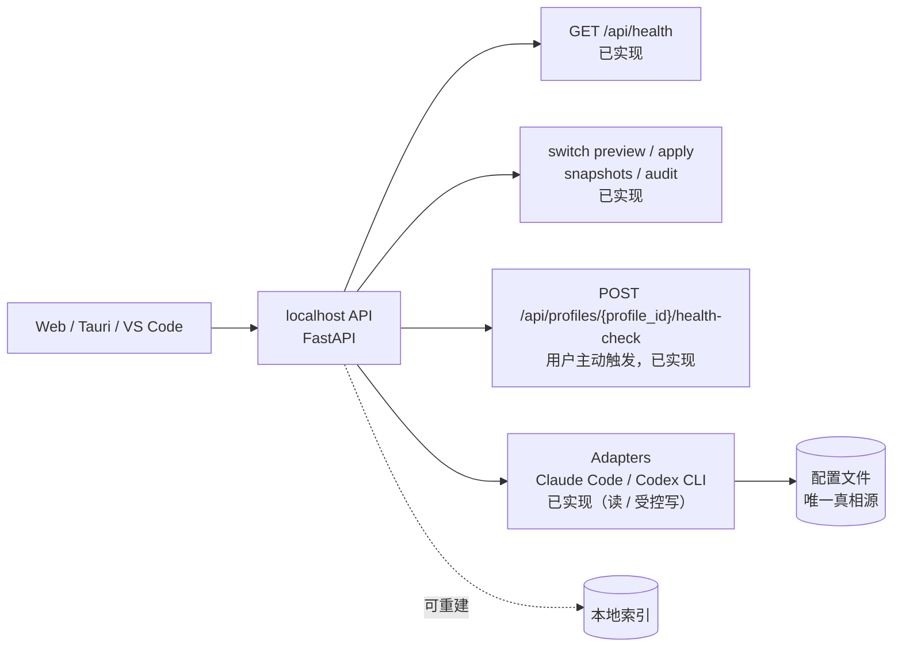

# CC-Roster

[](https://github.com/xming-cell/cc--/actions/workflows/ci.yml)

把电脑上所有 AI 编程工具的配置收进一个面板统一管理，并为在线聊天、agent 能力预留入口。

## 为什么

AI 编程工具越来越多，配置却散落在各自的目录和格式里：

1. **难找**：Claude Code、Codex 等工具的配置位置、字段各不相同，换台机器就要重新翻一遍。
2. **难管**：想统一查看或批量调整时，没有一处可以总览的地方。
3. **难扩展**：希望在一个面板里完成配置管理、在线聊天和 agent 会话，而不是在多个工具之间来回切换。

CC-Roster 不做「又一个 AI 客户端」，而是先把配置这层基础设施做好。

## 当前状态

**v0.0.1 · 基础设施阶段。** 任务卡 001–008、010、011 已完成；009 健康体检功能已实现，真实供应商手动验收待完成。

已落地：

- FastAPI 后端 + `GET /api/health`；所有错误统一返回 `{code, message}`
- 跨平台数据目录、SQLite 索引（WAL + `user_version` 幂等迁移）、原子 JSON 写与跨平台文件锁
- 结构化日志（stdout + 文件）与按 ADR-006 三档规则实现的密钥脱敏
- 本地安全边界：仅监听 `127.0.0.1`、CORS 白名单、1 MiB 请求体上限
- Vue 3 前端请求层（统一 `ApiError`）、路由、Pinia store 与应用壳；`/` 为微信式主界面：左侧好友列表、右侧详情 / 会话区骨架
- 主界面视觉 token（`frontend/src/styles/tokens.css`）：颜色 / 字号 / 间距 / 圆角 / 头像 / 气泡，提供 `--friend-accent` / `--friend-avatar-bg` / `--bubble-*` 覆盖点
- 好友外观（011）：默认颜色按工具 ID 稳定生成，可独立编辑强调色、聊天背景和气泡预设；用户覆盖存储在可删除重建的 `appearances.json`
- 工具发现：Claude Code / Codex CLI 适配器、`GET /api/tools`（支持 `name` / `provider` / `model` / `status` 过滤）、`GET /api/tools/{tool_id}`、`/` 主界面与 `/tools` 过渡入口；读取不写盘，008 起两个适配器声明 `write=true` / `write_mode="managed_fields"`，写入只发生在显式 apply；密钥只返回脱敏预览
- 供应商档案：`/profiles` 管理页与 `/api/profiles`，档案 CRUD / 复制 / 模型清单 / 删除保护 / 工具绑定（绑定本身不写工具配置；显式应用后才写入并记录 `active` / `applied_at` / `snapshot_id`）；密钥优先存 OS 钥匙串，不可用时回退本机 `secrets.json`（Unix `0600`）
- 健康体检：用户在 `/profiles` 主动选择模型并触发一次真实、最小化的非流式探测；不后台轮询、不自动重试、不持久化结果，也不修改档案、密钥或工具配置
- 快照与回滚内核：内容寻址分块存储、按工具的保留策略与 pin、外部改动检测、保真编辑助手、原子写引擎（写锁 / 预快照 / 回读校验 / 失败还原）、`/api/snapshots` 列表 · 详情 · pin · 回滚、`audit_entries` 审计
- 一键切换与改动预览：`POST /api/switch/preview`（零写入）与 `/apply`（快照 → 原子写 → 回读 → 审计 → 绑定，失败自动还原）、`GET /api/audit`；主界面「切换档案」预览确认框与字段级 diff、「快照 / 回滚」面板；冲突 / 过期 digest / 权限 / 协议 / OAuth 等 blocker 与 warning 可读展示；密钥写入工具配置，API / 日志 / 错误 / 审计 / 快照 `meta.json` 全程脱敏
- `scripts/check.py` 一键验收（含改动范围 / 禁用写法门禁），GitHub Actions CI 已接通
- 需求草案、后续任务拆解与架构决策（`docs/requirements.md`、`docs/task-plan.md`、`docs/decisions.md`）

规划中：

- 在线聊天与 agent 会话
- 审计 UI、全局只读模式等按 `docs/task-plan.md` 的后续任务卡推进

## 设计原则

1. **配置文件是唯一真相源**，数据库只是可重建的索引。
2. **先只读，后写入**；任何写入都必须可回滚。
3. **不自己造 agent runtime**，CLI 就是后端。

## 架构

目标架构如下，虚线部分尚未实现：



## 技术栈

| 层 | 技术 |
|---|---|
| 后端 | Python 3.12 · FastAPI · Pydantic v2 · tomlkit · uv |
| 前端 | Vue 3 · TypeScript · Vite · Pinia · Vue Router · pnpm |
| 质量 | Ruff · mypy · pytest · Oxlint / ESLint · vue-tsc · Vitest |
| CI | GitHub Actions |

## 快速开始

### 环境要求

- Python ≥ 3.12，包管理使用 [uv](https://docs.astral.sh/uv/)
- Node.js `^22.18.0 || >=24.12.0`，包管理使用 pnpm（CI 使用 9.x）
- 首次启动会自动创建 SQLite 索引与日志目录，无需手工建库

### 1. 启动后端

```bash
cd backend
uv sync --locked
uv run uvicorn app.main:app --reload --host 127.0.0.1 --port 8000
```

- 只监听回环地址 `127.0.0.1`，不提供局域网 / 远程访问。
- 启动时创建 `<数据目录>/db/app.sqlite3` 与 `<数据目录>/logs/`，数据目录见「本地数据目录」。
- 健康检查：<http://127.0.0.1:8000/api/health> → `{"status":"ok"}`
- 接口文档：<http://127.0.0.1:8000/docs>
- 删除 `<数据目录>/db/app.sqlite3` 后重启会自动重建，不需要迁移命令。

### 2. 启动前端

另开一个终端：

```bash
cd frontend
pnpm install --frozen-lockfile
pnpm dev
```

打开 <http://localhost:5173> 即进入微信式主界面：左侧是已发现 AI 工具的好友列表，右侧显示选中工具的详情、「切换档案」预览应用区与「快照 / 回滚」区；`/tools` 保留为工具发现的过渡入口，`/profiles` 是供应商档案管理页。Vite 会把 `/api` 代理到 `http://127.0.0.1:8000`，见 `frontend/vite.config.ts`。

### 3. 一键验收

在仓库根目录运行：

```bash
uv run python scripts/check.py
```

它会依次执行：

1. `guard scope` / `guard forbidden`：改动范围与禁用写法检查
2. 后端：Ruff lint、Ruff format、mypy、pytest
3. 前端：类型检查、lint、Vitest

**退出码为 0 是唯一的完成信号。**

## 主界面（微信式骨架）

`/` 是打开即见的微信式主界面，数据来自 `GET /api/tools`：

- **好友 = 已安装的 AI 工具**（ADR-002）。左侧列表每行含头像位、名称、一行状态描述与四态徽章（正常 / 未配置 / 异常 / 检测中），按 `last_modified` 降序排列，时间缺失或非法排最后，同值按名称 / ID 稳定排序。
- 点击好友后，右侧显示名称、状态与 004 的只读配置详情（供应商、模型、接口地址、第三方中转、脱敏密钥、最后修改时间、配置路径与 warnings）；未选中时显示「选择一个 AI 查看详情」。会话时间线容器已预留，本阶段不渲染会话内容。
- 详情内还有「切换档案」与「快照 / 回滚」：切换区选择档案 / 模型、预览逐字段改动并确认应用；快照区列出快照、pin / unpin 与确认回滚。应用成功后刷新工具详情、档案绑定与快照列表，并显示快照 ID 与重启要求；`/profiles` 的绑定状态同步显示「已应用」「尚未应用」或「档案已修改，需重新应用」。
- 无工具时显示「还没有发现任何 AI 工具」与「怎么装」静态指引（Claude Code / Codex CLI，不发网络请求）；部分工具失败时其他好友照常展示，全局 warnings 可折叠查看。
- 首屏先渲染骨架与「检测中」，初始失败给出可读错误与「重试」；刷新失败保留旧列表并给出非阻塞提示。
- 键盘可用：Tab 可达、Enter / Space 选中、focus 可见；窗口窄于 768px 时改为单列，无横向滚动。

## 好友外观（011）

- 未保存覆盖时，主色按稳定 `tool_id` 确定性生成；供应商 / 模型家族只影响次级强调色、聊天背景和默认气泡预设，不随档案切换或好友排序改变。
- 选中好友后，在详情的「好友外观」面板选择「编辑外观」，可修改强调色、聊天背景色和气泡样式；保存立即应用到该好友列表项、头像、详情和时间线预留区，刷新后仍保留。取消不会改动已应用外观，「恢复默认」经确认后只清除此工具的覆盖。
- 明 / 暗外观由系统偏好自动适配；颜色配对保证文本对比度。编辑控件可用键盘操作，窄屏会换行。
- 只有用户显式保存的覆盖写入 `<数据目录>/appearances.json`（schema version 1，以工具 ID 为键），默认外观不会落盘。该文件与档案、工具配置、快照、审计和数据库独立；删除它只会清除外观覆盖，重启后按工具身份重建默认样式。损坏或不支持的版本会报告错误，不会静默覆盖旧文件。

`/tools` 保留为工具发现的过渡入口，行为与 004 一致，后续卡片会逐步并入主界面。

## 工具发现（只读）

`GET /api/tools` 返回已安装工具与顶层 warnings，支持 `name` / `provider` / `model` / `status` 查询参数进行纯内存组合过滤；`GET /api/tools/{tool_id}` 返回单个工具；未知 ID 返回 404 `{code: "TOOL_NOT_FOUND", message}`。前端页面为 <http://localhost:5173/tools>，列表展示状态、供应商、模型，详情展示接口地址、第三方中转、脱敏密钥、最后修改时间、配置路径与 warnings。

- 只读取用户级配置：Claude Code 的 `settings.json`（`CLAUDE_CONFIG_DIR`，默认 `~/.claude`）与 Codex CLI 的 `config.toml` + `auth.json`（`CODEX_HOME`，默认 `~/.codex`）；不读 OAuth / 登录凭据，不执行 CLI 子进程。
- 读取全程只读：不修改配置文件、不生成临时文件；密钥只以 `has_secret` + 脱敏 `secret_preview` 返回。
- 008 起两个适配器的 `capabilities.write=true`、`write_mode="managed_fields"`；`GET /api/tools` 仍然只读，写入只通过显式的 `POST /api/switch/apply`。
- 已安装判定：配置目录存在，或 `claude` / `codex` 在 `PATH` 中。只有可执行文件、没有配置时显示「未配置」。
- 环境变量为空串时回退默认目录；相对路径按用户 home 解析。

### 本地验收

用临时目录避免碰到真实配置（Windows PowerShell）：

```powershell
$root = Join-Path $env:TEMP "cc-roster-acceptance"
New-Item -ItemType Directory -Force "$root\claude", "$root\codex" | Out-Null
@'
{
  "model": "claude-sonnet-4-5",
  "env": {
    "ANTHROPIC_BASE_URL": "https://api.anthropic.com",
    "ANTHROPIC_AUTH_TOKEN": "sk-your-key"
  }
}
'@ | Set-Content "$root\claude\settings.json" -Encoding utf8

$env:CLAUDE_CONFIG_DIR = "$root\claude"
$env:CODEX_HOME = "$root\codex"
cd backend
uv run uvicorn app.main:app --reload --host 127.0.0.1 --port 8000
```

前端另开终端 `cd frontend && pnpm dev`，然后打开 <http://localhost:5173> 查看主界面，或打开 <http://localhost:5173/tools> 查看工具发现过渡入口；也可直接请求：

```bash
curl http://127.0.0.1:8000/api/tools
curl http://127.0.0.1:8000/api/tools/claude-code
curl -i http://127.0.0.1:8000/api/tools/not-a-tool   # 404 TOOL_NOT_FOUND
```

验收要点：Claude Code 显示正常、Codex CLI 显示未配置；把 `settings.json` 改坏一个字符后刷新，只有 Claude Code 变为异常并提示行 / 列；响应里只出现脱敏密钥；读取前后配置文件的 SHA-256 不变。

bash / macOS / Linux 等价写法：

```bash
mkdir -p "$TMPDIR/cc-roster-acceptance/claude" "$TMPDIR/cc-roster-acceptance/codex"
export CLAUDE_CONFIG_DIR="$TMPDIR/cc-roster-acceptance/claude"
export CODEX_HOME="$TMPDIR/cc-roster-acceptance/codex"
```

## 供应商档案（`/profiles`）

`/profiles` 管理可复用的供应商档案：一份档案由「名称 + 协议 + 接口地址 + 模型清单 + 密钥」组成，可绑定给多个工具，也可在多个档案之间切换。

- **档案**：新建 / 编辑 / 复制 / 删除；名称大小写不敏感唯一；`base_url` 只接受绝对 `http(s)` 地址；模型清单可空，重复模型（去空白后完全相同）拒绝保存并指出重复项。
- **密钥**：档案只保存 `secret_ref`，界面只显示 `secret_preview`（ADR-006 三档脱敏），没有查看 / 导出完整密钥的入口；编辑时密钥留空 = 保持，勾选「清除已保存的密钥」= 删除。
- **绑定**：每个工具至多绑定一份档案；同一份档案可绑定 Claude Code 与 Codex CLI。绑定只写应用侧 `profiles.json`，**不写工具配置文件**，界面显示「已绑定，尚未应用」；在主界面应用成功后显示「已应用（时间，快照 ID）」，档案 `updated_at` 晚于 `applied_at` 时显示「档案已修改，需重新应用」。解除绑定也不会回滚工具里已生效的配置。
- **删除保护**：档案被任何工具绑定（含已卸载工具）时，未确认删除返回 409 `PROFILE_IN_USE` 并列出占用方；确认后同时删除档案、全部绑定与密钥。
- **降级**：密钥引用存在但读不到时显示 `SECRET_MISSING` warning，列表继续可用；`profiles.json` 损坏或版本不支持时返回可读错误，且不覆盖原文件。

### API

| 方法 | 路径 | 说明 |
|---|---|---|
| `GET` | `/api/profiles` | 档案列表、绑定、密钥后端状态与 warnings |
| `POST` | `/api/profiles` | 新建档案（201） |
| `GET` | `/api/profiles/{profile_id}` | 档案详情 |
| `PATCH` | `/api/profiles/{profile_id}` | 部分更新；省略 `secret` 保持、`null` 清除、字符串替换 |
| `POST` | `/api/profiles/{profile_id}/copy` | 复制档案（201，不复制绑定） |
| `DELETE` | `/api/profiles/{profile_id}?confirm=true` | 删除档案；未确认且被占用时 409 |
| `PUT` | `/api/tools/{tool_id}/profile` | 绑定工具到档案（body `{profile_id}`） |
| `DELETE` | `/api/tools/{tool_id}/profile` | 解除绑定；幂等，无绑定返回 `removed=false` |
| `POST` | `/api/profiles/{profile_id}/health-check` | 按档案协议检测所选模型；只返回本次结果，不写入档案或历史 |

错误统一为 `{code, message}`，常见错误码：`PROFILE_NOT_FOUND`、`PROFILE_NAME_CONFLICT`、`PROFILE_IN_USE`、`PROFILE_STORE_UNREADABLE`、`PROFILE_STORE_VERSION_UNSUPPORTED`、`SECRET_STORE_ERROR`、`TOOL_NOT_FOUND`。

### 健康体检（009）

在 `/profiles` 每张档案卡片中选模型并点「体检」即可主动检查连通性。默认选模型清单第一项；清单为空时按钮禁用。每次操作只发一个非流式最小请求，超时上限 10 秒，不跟随重定向、不自动重试，也不发送用户对话内容。此请求会到达档案中的供应商地址，供应商可能按其规则计费；无后台或定时请求。

密钥只在本次请求中用于协议认证，不进入响应或日志；上游错误正文不会原样回显。页面会显示连通状态、失败类型、可读说明和耗时。可能的结果包括 `CONNECTED`、`INVALID_CREDENTIALS`、`INVALID_ADDRESS`、`MODEL_NOT_FOUND`、`TIMEOUT`、`RATE_LIMITED`、`SECRET_MISSING`、`SECRET_STORE_ERROR` 与 `UNKNOWN`。没有模型时返回 `MODEL_REQUIRED`，不发网络请求。

可直接验收 API（先从 `/api/profiles` 选择档案 ID 和其清单中的模型）：

```bash
curl -i -X POST http://127.0.0.1:8000/api/profiles/<profile_id>/health-check \
  -H 'Content-Type: application/json' \
  -d '{"model":"<listed-model-id>"}'
```

真实供应商验收应使用专门的测试档案，不要绑定或应用到工具；由用户选择地址、模型和凭证。依次检查正确地址 / 有效凭证、不可达地址、临时无效 key，以及档案清单中但供应商不存在的模型。修改测试档案后恢复原值或删除测试档案；不得把密钥写入命令历史、截图或记录。测试前后核对档案与密钥状态、工具配置文件、快照和审计数据；只记录供应商、模型与诊断结论，不记录密钥。

### 密钥存储与回退

- 默认 `CC_ROSTER_SECRET_BACKEND=auto`：优先 OS 钥匙串（Windows 凭据管理器 / macOS Keychain / Linux Secret Service，条目名 `cc-roster/<profile_id>`）；探测不到可用后端时回退 `<数据目录>/secrets.json`，Unix 权限 `0600`，界面显示非阻塞 banner。
- `CC_ROSTER_SECRET_BACKEND=file`：强制使用本机文件，便于验收回退路径。
- `CC_ROSTER_SECRET_BACKEND=keyring`：强制使用钥匙串；不可用时写入操作返回可读错误，不静默回退。
- `secrets.json` 是**明文**文件，不是加密保险箱；使用文件回退时请限制目录访问权限，并避免把该文件提交到仓库或云盘。
- 读取始终按档案里的 `SecretRef.backend` 路由，因此钥匙串恢复后仍能读取旧的 file 密钥。

### 本地验收

后端启动后打开 <http://localhost:5173/profiles>：

1. 新建一份带密钥的档案并刷新：列表只显示脱敏预览；`profiles.json` 中只有 `secret_ref`，没有明文；Windows 可用 `cmdkey /list` 看到 `cc-roster/<profile_id>` 条目。
2. 编辑档案，密钥留空保存（预览不变）；再勾选「清除已保存的密钥」保存（`has_secret=false`，钥匙串条目被删除）。
3. 把同一份档案绑定到 Claude Code 与 Codex CLI：两处都显示「已绑定，尚未应用」，`used_by` 同时列出两个工具，工具配置文件不变；到主界面应用后绑定变为「已应用（时间，快照 ID）」。
4. 重启后端再打开 `/profiles`：档案、模型清单、绑定与密钥状态全部保留。
5. 删除被占用的档案：先取消（磁盘零变化），再确认（档案 / 绑定 / 密钥删除，工具配置不变）。
6. 复制一份带密钥的档案：新 ID / 新名称，协议 / 地址 / 模型 / 密钥相同，不带绑定。
7. 回退路径：`CC_ROSTER_SECRET_BACKEND=file` 启动后端，页面显示「系统钥匙串不可用，密钥保存在本机文件」banner；新建 / 编辑 / 删除密钥正常；Unix 下 `secrets.json` 权限为 `0600`。
8. 损坏恢复：手工把 `profiles.json` 改坏后刷新，页面显示可读错误且不覆盖坏文件；恢复备份后列表正常。
9. 键盘与窄窗口（约 320px）：Tab 可达、focus 可见、无横向滚动，dialog 可用键盘关闭 / 确认。

也可直接请求：

```bash
curl http://127.0.0.1:8000/api/profiles
curl -i -X POST http://127.0.0.1:8000/api/profiles \
  -H 'Content-Type: application/json' \
  -d '{"name":"Anthropic","protocol":"anthropic","base_url":"https://api.anthropic.com","secret":"sk-your-key"}'
curl -X PUT http://127.0.0.1:8000/api/tools/claude-code/profile \
  -H 'Content-Type: application/json' -d '{"profile_id":"<profile_id>"}'
curl -i -X DELETE "http://127.0.0.1:8000/api/profiles/<profile_id>"   # 被占用时 409 PROFILE_IN_USE
```

PowerShell 下启动文件回退：

```powershell
$env:CC_ROSTER_SECRET_BACKEND = "file"
cd backend
uv run uvicorn app.main:app --reload --host 127.0.0.1 --port 8000
```

## 一键切换与改动预览（008）

主界面选中工具后，「切换档案」负责把某个供应商档案应用到工具配置，「快照 / 回滚」负责查看与恢复。核心原则：**预览零写入；应用必须可追溯、可回滚；失败不假成功。**

### 流程

1. 工具先绑定档案（在 `/profiles` 或切换区选择；绑定本身不写配置）。
2. 点「预览改动」：服务端重新读取档案、密钥与目标文件，生成内存计划与逐字段 before / after；不建快照、不写审计、不创建目录。
3. 确认框展示目标文件、字段级 diff、blockers / warnings 与重启提示；有 blocker 时不能确认。
4. 确认应用时，前端原样回传预览的 `preview_digest` 与 `observations`。服务端重新生成计划，按「文件观察值 → digest → blockers」复核；任何一项不一致都拒绝写入。
5. 通过后由 007 写引擎在写锁内预快照 → 逐文件原子写 → 回读校验 → 审计；随后把绑定标记为 `active=true` 并记录 `applied_at` / `snapshot_id`。
6. 响应与界面显示快照 ID、逐文件结果与重启要求；绑定保存失败会用本次快照自动回滚，回滚也失败返回 `APPLY_ROLLBACK_FAILED`，绝不返回成功。

### 字段映射

| 工具 | 目标文件 | 托管字段 | 重启 |
|---|---|---|---|
| Claude Code | `<CLAUDE_CONFIG_DIR 或 ~/.claude>/settings.json` | `env.ANTHROPIC_BASE_URL`、模型（`env.ANTHROPIC_MODEL` 优先，其次顶层 `model`）、密钥（已有 `ANTHROPIC_AUTH_TOKEN` 优先，否则 `ANTHROPIC_API_KEY`） | Claude Code 需要重启后才会读取新的 `settings.json` |
| Codex CLI | `<CODEX_HOME 或 ~/.codex>/config.toml` + `auth.json` | 顶层 `model`、`model_provider="openai"`、`[model_providers.openai]` 的 `name` / `base_url` / `wire_api`（官方 host 用 `responses`，第三方用 `chat`）、`auth.json.OPENAI_API_KEY` | Codex CLI 需要重启后才会读取新的 `config.toml` / `auth.json` |

- Claude Code 只接受 `anthropic` 档案，Codex CLI 只接受 `openai` 档案；协议不匹配是 blocker，零写入。
- Claude Code 的模型优先更新已有 `env.ANTHROPIC_MODEL`，其次顶层 `model`；凭证优先更新已有 `env.ANTHROPIC_AUTH_TOKEN`，其次 `env.ANTHROPIC_API_KEY`（两者同时存在时更新 `AUTH_TOKEN` 并删除 `API_KEY`）。两种凭证都不存在时，官方 host 写 `ANTHROPIC_API_KEY`，第三方写 `ANTHROPIC_AUTH_TOKEN`。
- 模型默认档案清单第一项，可在预览中改选清单内其他项；清单为空时保持工具当前模型。
- 只改托管字段；注释、键序、未知字段与其余内容逐字符保持不变。无法保证保真（重复键、非法 JSON / TOML、非 UTF-8、顶层类型不符等）时返回 blocker / `UNSAFE_WRITE`，不猜、不写。
- Codex 的 `env_key` 已存在且不是 `OPENAI_API_KEY` 时返回 `ENV_KEY_CONFLICT` blocker；`auth.json` 里的 OAuth 字段原样保留并给 `OAUTH_AUTH_PRESENT` warning。
- 档案没有密钥时不增删凭证字段，返回 `PROFILE_SECRET_EMPTY` warning（保留工具现有密钥 / 认证信息）。

### API

| 方法 | 路径 | 说明 |
|---|---|---|
| `POST` | `/api/switch/preview` | 只读预览；返回逐文件 hash / 大小 / 字段级变更、blockers / warnings、观察值、`preview_digest`、`can_apply` |
| `POST` | `/api/switch/apply` | 应用；请求必须原样带上预览返回的 `preview_digest` 与 `observations` |
| `GET` | `/api/audit?tool_id=&limit=50` | 审计列表（`limit` 1–200，默认 50）；只含路径 / 字段 / 结果 / 脱敏消息 |

审计响应为 `{"entries": [...]}`，按时间倒序；每条含 `id` / `created_at` / `action`（apply / rollback）/ `tool_id` / `profile_id` / `snapshot_id` / `files` / `fields` / `result`（success / failed / conflict）/ `message`，不含文件原文或明文密钥。

预览请求：

```bash
curl -X POST http://127.0.0.1:8000/api/switch/preview \
  -H 'Content-Type: application/json' \
  -d '{"tool_id":"claude-code","profile_id":"<profile_id>","model":"claude-sonnet-4-5"}'
```

响应要点（省略号为真实值）：

```json
{
  "tool_id": "claude-code",
  "profile_id": "...",
  "model": "claude-sonnet-4-5",
  "available_models": [{"id": "claude-sonnet-4-5", "display_name": null}],
  "files": [{
    "path": "/tmp/.../claude/settings.json",
    "format": "json",
    "action": "updated",
    "before_sha256": "...",
    "after_sha256": "...",
    "before_size": 120,
    "after_size": 140,
    "changes": [{
      "path": "/tmp/.../claude/settings.json",
      "field": "env.ANTHROPIC_BASE_URL",
      "action": "set",
      "before": "https://api.anthropic.com",
      "after": "https://relay.example.com"
    }]
  }],
  "blockers": [],
  "warnings": [],
  "restart_required": true,
  "restart_message": "Claude Code 需要重启后才会读取新的 settings.json",
  "observations": [{"path": "/tmp/.../claude/settings.json", "exists": true, "sha256": "...", "size": 120, "mtime_ns": 1700000000000000000}],
  "preview_digest": "...",
  "can_apply": true
}
```

应用请求把 `preview_digest` 与 `observations` 原样回传（不要手改观察值）。PowerShell 下可直接串联预览与应用：

```powershell
$preview = Invoke-RestMethod -Method Post -Uri http://127.0.0.1:8000/api/switch/preview `
  -ContentType 'application/json' `
  -Body '{"tool_id":"claude-code","profile_id":"<profile_id>","model":"claude-sonnet-4-5"}'

$applyBody = @{
  tool_id = 'claude-code'
  profile_id = '<profile_id>'
  model = 'claude-sonnet-4-5'
  preview_digest = $preview.preview_digest
  observations = $preview.observations
} | ConvertTo-Json -Depth 10

Invoke-RestMethod -Method Post -Uri http://127.0.0.1:8000/api/switch/apply `
  -ContentType 'application/json' -Body $applyBody
```

bash 下可用 `jq` 把预览响应的 `preview_digest` / `observations` 拼进 apply 请求。成功响应含 `snapshot_id`、`audit_id`、`files`（路径 / 动作 / hash / 大小）、`binding`（`active=true`、`applied_at`、`snapshot_id`）与 `restart_message`。

错误与详情：

| 状态 | 错误码 | 含义 |
|---|---|---|
| 404 | `TOOL_NOT_FOUND` / `PROFILE_NOT_FOUND` | 工具未安装 / 档案不存在 |
| 409 | `SWITCH_BLOCKED` | 仍有 blocker（协议、权限、格式、`env_key` 等） |
| 409 | `SWITCH_PREVIEW_STALE` | 预览后档案 / 模型 / 密钥变化；`details.stale_paths` 列出文件 |
| 409 | `WRITE_CONFLICT` | 预览后文件被删除 / 新建 / 改内容；`details.conflicts` 含两边观察值，绝不覆盖 |
| 422 | `SWITCH_MODEL_UNKNOWN` / `VALIDATION_ERROR` | 模型不在档案清单 / 请求形状非法 |
| 500 | `WRITE_VERIFY_FAILED` / `WRITE_FAILED` / `WRITE_RESTORE_FAILED` / `AUDIT_WRITE_FAILED` / `BINDING_WRITE_FAILED` / `APPLY_ROLLBACK_FAILED` | 写入、回读、审计或绑定失败；已按预快照还原，未还原成功会明确返回 |
| 503 | `WRITE_LOCK_TIMEOUT` / `PROFILE_STORE_LOCK_TIMEOUT` | 并发写锁 / 档案锁超时，可重试 |

`WRITE_CONFLICT` 与 `SWITCH_PREVIEW_STALE` 的错误响应带可选 `details`；其他错误仍是 `{code, message}`。冲突**不自动合并**：界面保留确认框，显示冲突文件和原因，重新预览后才能再次应用。

### 密钥与脱敏边界

- 档案密钥会写入工具配置（Claude Code 的 `env` 或 Codex 的 `auth.json`），这是切换功能的目的；工具配置文件本身含明文是预期行为。
- API 响应、预览 diff、日志、错误、审计、快照 `meta.json` 都不出现明文密钥；预览里的密钥字段显示脱敏后的旧值 / 新值。
- 快照 blob 保存写入前原始字节，可能含旧密钥；不提供快照内容下载 / 导出接口，`snapshots/` 要按密钥材料保管（见「本地数据目录」）。
- 审计只记录 `path.field`、快照 ID、结果与脱敏消息；`GET /api/audit` 不返回文件内容。

### 前端入口

- 主界面好友详情内：「切换档案」（档案 / 模型选择、预览、字段级 diff、blockers / warnings、重启提示、取消零请求、冲突后重新预览）与「快照 / 回滚」（列表、空状态、warnings、pin / unpin、确认回滚、回滚前快照 ID、恢复文件）。
- 应用成功后自动刷新工具详情、档案绑定与快照列表；`/profiles` 的绑定面板显示「已应用（时间 / 快照 ID）」「已绑定，尚未应用」或「档案已修改，需重新应用」。
- 键盘：Tab 可达，Enter / Space 触发，Esc 关闭预览 / 回滚确认框；窄屏 < 768px 单列。

### 本地验收

用临时目录，避免碰真实配置（bash / macOS / Linux；Windows PowerShell 见下）：

```bash
root="${TMPDIR:-/tmp}/cc-roster-switch"
mkdir -p "$root/claude" "$root/codex"
printf '%s\n' '{"model":"claude-sonnet-4-5","env":{"ANTHROPIC_BASE_URL":"https://api.anthropic.com","ANTHROPIC_AUTH_TOKEN":"sk-old"}}' > "$root/claude/settings.json"
export CLAUDE_CONFIG_DIR="$root/claude"
export CODEX_HOME="$root/codex"
export CC_ROSTER_SECRET_BACKEND=file
cd backend && uv run uvicorn app.main:app --host 127.0.0.1 --port 8000
```

1. 在 `/profiles` 新建 `anthropic` 档案（`base_url` 如 `https://relay.example.com`，模型 `claude-sonnet-4-5`，密钥 `sk-new`），记下 `profile_id`。
2. 记录 `settings.json` 的 SHA-256，调用预览，确认 `changes` 逐字段可见、密钥是脱敏值，且文件 hash、`snapshots/`、`audit_entries` 数量不变。
3. 用预览返回的 `preview_digest` / `observations` 调用 apply，确认目标字段写入、其余字节不变、`snapshot_id` / `audit_id` / 绑定齐全、响应与日志无明文密钥。
4. 预览后手工修改 `settings.json` 再 apply：应返回 409 `WRITE_CONFLICT`，文件不被覆盖；重新预览后可再次应用。
5. 把 `settings.json` 设为只读（Windows 用 `attrib +r`，Unix 用 `chmod a-w`）后预览：应出现 blocker / 可读错误，apply 零写入。
6. 应用后调用 `POST /api/snapshots/<snapshot_id>/rollback`（或界面回滚），确认生成回滚前快照，文件与 apply 前逐字节一致（`sha256sum` / `Get-FileHash`）。
7. `GET /api/audit?tool_id=claude-code` 能看到 apply / 冲突 / 回滚记录；`GET /api/snapshots?tool_id=claude-code` 能看到快照与 pin 状态。
8. 取消预览与回滚确认框，确认磁盘零变化；窄屏与键盘操作可用。

Windows PowerShell 下等价命令：

```powershell
$root = Join-Path $env:TEMP "cc-roster-switch"
New-Item -ItemType Directory -Force "$root\claude", "$root\codex" | Out-Null
'{"model":"claude-sonnet-4-5","env":{"ANTHROPIC_BASE_URL":"https://api.anthropic.com","ANTHROPIC_AUTH_TOKEN":"sk-old"}}' |
  Set-Content "$root\claude\settings.json" -Encoding utf8
$env:CLAUDE_CONFIG_DIR = "$root\claude"
$env:CODEX_HOME = "$root\codex"
$env:CC_ROSTER_SECRET_BACKEND = "file"
Get-FileHash "$root\claude\settings.json" -Algorithm SHA256
```

Codex 验收：在临时 `CODEX_HOME` 下预览 / 应用 `openai` 档案，检查 `config.toml` 的 `model` / `model_provider` / `[model_providers.openai]` 与 `auth.json.OPENAI_API_KEY`；再用该 `CODEX_HOME` 启动真实 Codex，确认读到所选 provider / model / key。若当前版本优先 OAuth 或忽略 `auth.json`，按实测记录并调整映射，不静默失败。

## 快照与回滚内核

007 交付快照与写引擎内核；008 已把适配器的 `plan` / `render` / `verify` 与 preview / apply 端点接上。任何一次 apply 在落盘前先捕获快照，写入后逐字节回读校验；失败时用同一份预快照还原全部文件。快照查询、pin 与回滚 API 见下。

### 存储布局

```text
<数据目录>/snapshots/
├── .lock                                  # 捕获 / pin / 清理的文件锁
├── objects/<sha256 前 2 位>/<完整 sha256>  # 内容块, 跨快照去重
└── <snapshot_id>/meta.json                # schema_version / tool_id / profile_id /
                                            # created_at / reason / pinned / files / changes
```

- 文件按默认 1 MiB 分块，每个块与整文件都记录 SHA-256；空文件和「快照时不存在」分开建模。
- `meta.json` 原子替换，崩溃不会留下半截 JSON；`objects/` 按内容寻址，只有最后一个引用消失后才回收。
- 捕获 / pin / 清理在 `snapshots/.lock` 内串行化；写引擎与回滚另持有 `<数据目录>/locks/write.lock`。
- Unix 下快照目录 `0700`、文件 `0600`；Windows 依赖用户目录 ACL。

### 保留策略与 pin

- `CC_ROSTER_SNAPSHOT_RETENTION` 配置每个工具保留的快照总数，默认 `20`，合法范围 `1–1000`；非法值启动即报错，不静默回退。
- 每次捕获后，按 `tool_id` 独立删除最旧的未 pin 快照，直到总数不超过 N；`pinned=true` 的快照永不自动删除。全部快照都 pin 时允许超过 N。
- `PATCH` pin / unpin 幂等，只重写 `meta.json`，不改变 `created_at`、不复制内容块。
- 回滚前的预快照参与保留计算，但回滚目标本身受保护，不会在回滚过程中被清理；无法回收的对象会在清理时一并删除。

### API

| 方法 | 路径 | 说明 |
|---|---|---|
| `GET` | `/api/snapshots?tool_id=&limit=50` | 列表（`limit` 1–200）；返回 `snapshots`、`retention_limit`、`warnings` |
| `GET` | `/api/snapshots/{snapshot_id}` | 详情；文件只含路径 / hash / 大小 / mtime / mode 与变更摘要 |
| `PATCH` | `/api/snapshots/{snapshot_id}` | body `{"pinned": true|false}`，幂等 |
| `POST` | `/api/snapshots/{snapshot_id}/rollback` | 回滚到该快照，返回预回滚快照 ID 与逐文件动作 |

- 未知快照 → 404 `SNAPSHOT_NOT_FOUND`；非规范 UUID4 → 422 `VALIDATION_ERROR`；快照损坏 → 500 `SNAPSHOT_UNREADABLE`。
- 列表遇到损坏的 `meta.json` 不整体失败：跳过该条并放进 `warnings`，其余快照照常返回。
- 响应**绝不包含**原始内容、chunk 数据或明文密钥；没有快照内容下载端点。

### 回滚语义

1. 回滚先在写锁内完整读取并校验目标快照的所有块与整文件 hash；校验失败时**不写任何文件**。
2. 为所有目标文件的当前状态生成 `reason=rollback` 的预回滚快照；目标快照 ID 受保留保护。
3. 逐文件 `os.replace` 恢复：快照里存在的文件写回原字节（Unix 恢复原 mode），快照里不存在的文件删除。
4. 全部写入后逐字节回读校验。任一失败用预回滚快照还原所有文件；还原失败返回 `ROLLBACK_FAILED`，绝不报告成功。
5. 审计写入失败也会先还原文件，再返回 `AUDIT_WRITE_FAILED`。

### 安全边界

- 快照 blob 保存的是**原始字节**，其中可能包含 API key、token 或其它敏感值；这是回滚能力的代价。
- 原始字节只允许留在 `snapshots/objects/` 内：API、日志、diff、审计、变更摘要都不输出明文。`SnapshotChange.before/after` 在构造时脱敏并截断，审计的文件 / 字段 / message 在落库前再次脱敏。
- 不提供按快照下载 / 导出文件内容的接口；详情与列表只给 hash、大小、时间和脱敏变更。
- 备份或迁移数据目录时，`snapshots/` 要按密钥材料对待；不要把数据目录提交到仓库、同步到公共云盘或发给他人。不需要历史回滚时可删除整个 `snapshots/`，工具配置不受影响。
- 审计只存在 `db/app.sqlite3` 的 `audit_entries` 表；删除数据库会丢失审计索引（表会自动重建），但不会删除快照或工具配置。

### 本地验收

写引擎的失败注入由测试覆盖；端到端 apply / 回滚见上一节「本地验收」：

```bash
cd backend
uv run pytest tests/test_write_engine.py tests/test_snapshots_api.py -q
```

对已有快照的数据目录（执行过 apply 后）可直接用 curl：

```bash
curl http://127.0.0.1:8000/api/snapshots
curl http://127.0.0.1:8000/api/snapshots/<snapshot_id>
curl -X PATCH http://127.0.0.1:8000/api/snapshots/<snapshot_id> \
  -H 'Content-Type: application/json' -d '{"pinned": true}'
curl -X POST http://127.0.0.1:8000/api/snapshots/<snapshot_id>/rollback
```

验收要点：写入前出现快照且能看到文件 hash 与变更摘要；回读失败时目标文件恢复为写入前字节；外部改动后 apply 返回 `WRITE_CONFLICT` 且不覆盖；回滚后 `cmp` / `Get-FileHash` 与快照时一致并生成预回滚快照；pin 的最旧快照在超过保留上限后仍在，未 pin 的旧快照被清理；删除 `db/app.sqlite3` 重启后快照仍可列表 / 回滚，审计表自动重建。

## 本地数据目录

数据根目录按 [ADR-007](docs/decisions.md) 解析，应用启动时自动创建；目录已存在时不会重复创建或清空。

| 平台 | 数据根目录 |
|---|---|
| Windows | `%LOCALAPPDATA%\CC-Roster` |
| macOS | `~/Library/Application Support/CC-Roster` |
| Linux | `${XDG_DATA_HOME:-$HOME/.local/share}/cc-roster` |

当前使用的位置：

| 路径 | 内容 | 删除后的影响 |
|---|---|---|
| `db/app.sqlite3` | SQLite 索引、缓存与 `audit_entries` 审计（WAL 模式，`user_version` 幂等迁移） | 可删除，重启后自动重建；丢失审计记录，不影响工具配置、档案与快照 |
| `logs/app.log` | 应用日志（已脱敏） | 可删除，无影响 |
| `snapshots/` | 快照 `meta.json`、内容寻址块 `objects/` 与 `.lock`（原始字节；Unix 目录 `0700` / 文件 `0600`） | 丢失历史回滚能力；工具配置与档案不受影响；**按密钥材料保管，不要提交 / 公开同步** |
| `locks/write.lock` | 写引擎与回滚共用的写锁 | 无影响，可删除；不需要备份 |
| `profiles.json` | 供应商档案与工具绑定（用户数据；原子写 + 文件锁） | 档案与绑定丢失；工具里已生效的配置不受影响；**请备份** |
| `appearances.json` | 好友外观的显式覆盖（版本化、原子写 + 文件锁；默认外观不存储） | 可删除；外观覆盖清除，重启后按工具 ID 恢复默认；不影响档案、配置、快照、审计或数据库 |
| `secrets.json` | 仅在 OS 钥匙串不可用或 `CC_ROSTER_SECRET_BACKEND=file` 时创建的密钥回退（明文，Unix `0600`） | 回退密钥丢失，界面显示 `SECRET_MISSING`；钥匙串中的密钥不受影响 |
| `profiles.lock` / `secrets.lock` | 写操作的文件锁 | 无影响，可删除；不需要备份 |

后续任务会按 ADR-007 增加 `cache/`、`settings.json`。

### 备份与恢复

- 备份用户数据：停止应用（或确保没有正在进行的写操作）后复制 `profiles.json`；如果使用文件密钥回退，连同 `secrets.json` 一起复制。
- **`snapshots/` 也可能含有明文密钥**（历史配置的原始字节）。需要保留回滚历史时，把整个 `snapshots/` 与 `profiles.json` / `secrets.json` 一样按密钥材料保管；否则可以排除它，只备份档案与密钥文件。
- `secrets.json` 是明文密钥文件，备份 / 迁移时要像对待密码一样保管；使用 OS 钥匙串时密钥不在数据目录，备份 `profiles.json` 不会复制密钥，换机后需重新录入。
- 恢复：把文件放回数据目录后重启即可。`profiles.json` 损坏时应用返回可读错误且**不会覆盖原文件**，恢复备份后重新打开 `/profiles`。

## 日志与脱敏

- 日志同时写 stdout 与 `<数据目录>/logs/app.log`，每行包含 UTC ISO 8601 时间、级别、logger 名与消息。
- 所有日志在输出前经过统一脱敏：`sk-...`、`Bearer ...`、`api_key=...` 等形态不会以明文出现。
- 密钥脱敏按 ADR-006 三档长度规则：长度 ≤ 8 全部替换为 `****`；9～16 保留前 2 + `****` + 后 2；> 16 保留前 4 + `****` + 后 4。
- 错误响应同样经过脱敏；未知异常只返回 500 `{"code": "INTERNAL_ERROR", "message": "服务器内部错误"}`，不包含 traceback、路径或异常原文。

## 本地安全边界

- 后端只监听回环地址 `127.0.0.1`，不对局域网暴露。
- CORS 只放行 `http://localhost:5173` 与 `http://127.0.0.1:5173`；其他来源不会收到 `Access-Control-Allow-Origin`。
- 请求体上限默认 1 MiB，超限返回 413 `{"code": "PAYLOAD_TOO_LARGE", "message": ...}`。
- 业务错误统一为 `{code, message}`；404 / 405 / 参数校验失败也使用同一形状。

## 目录结构

```text
.
├── backend/                 # FastAPI 服务
│   ├── src/app/api/         # 路由与全局异常处理器（tools / profiles / switch / snapshots / audit）
│   ├── src/app/services/    # 业务规则（工具发现、档案编排、切换编排、写引擎、快照回滚、审计）
│   ├── src/app/repositories/ # profiles.json / 快照 / 审计仓储与 SecretStore
│   ├── src/app/schemas/     # Pydantic 输入 / 输出模型
│   ├── src/app/adapters/    # Claude Code / Codex CLI 读写适配器、共享托管字段 helper 与显式注册表
│   ├── src/app/core/        # 配置、路径、DB、原子写、锁、脱敏、格式保真编辑
│   └── tests/
├── frontend/                # Vue 3 前端
│   └── src/
├── scripts/
│   ├── check.py             # 一键验收
│   └── guards.py            # 改动范围 / 禁用写法硬门禁
├── specs/                   # 任务卡；CURRENT 指向当前任务
├── rules/                   # 后端 / 前端 / 测试 / 提交细则
├── AGENTS.md                # AI 协作硬约定（开工前先读）
└── PROGRESS.md              # 跨会话交接状态
```

## 开发约定

- 开工前读 `AGENTS.md`、`rules/backend.md`、`rules/frontend.md`、`rules/testing.md`、`rules/git.md`。
- 当前任务看 `specs/CURRENT`；只改该任务卡 `scope` 块内的路径。
- 新增行为先写进任务卡的验收标准，再写实现。
- 一张任务卡对应一个 commit；`check.py` 通过后才提交。
- 详细规则以 `rules/` 为准，这里不重复。

## 文档

- [AGENTS.md](AGENTS.md)：AI 协作硬约定与验证命令
- [PROGRESS.md](PROGRESS.md)：当前进度、下一个可执行命令、已知坑
- [docs/requirements.md](docs/requirements.md)：产品需求草案
- [docs/task-plan.md](docs/task-plan.md)：后续任务拆解（初稿）
- [docs/decisions.md](docs/decisions.md)：已确认的架构决策（ADR-001～ADR-008）
- [rules/](rules/)：后端、前端、测试、提交细则
- [specs/](specs/)：任务卡与当前任务指针

## 许可证

[MIT](LICENSE) © 2026 xming-cell